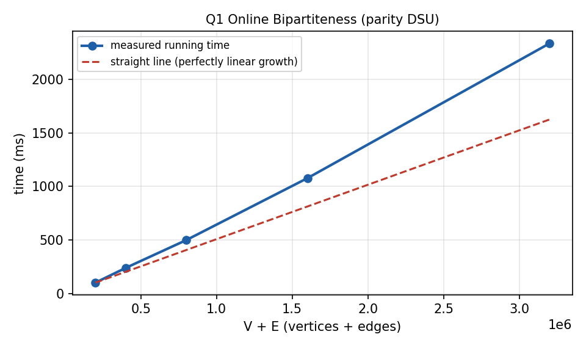

# Q1. Online Graph Bipartiteness Testing using DSU with Parity

## 1. Problem Title

**Online Graph Bipartiteness Testing using DSU with Parity**

---

## 2. Problem Statement

A graph is bipartite **if and only if** it contains no odd-length cycle. We are given an undirected graph with `V` vertices. Edges arrive **online**, one at a time. For every arriving edge `(u, v)`:

- if adding `(u, v)` does **not** create an odd cycle, the edge is added;
- otherwise the program reports that the edge violates bipartiteness and **skips** it.

Hence the graph that is actually maintained is always bipartite. The program must validate the algorithm in C and give a complexity analysis.

### Modelling assumptions

- Vertices are numbered `1..V`.
- A self-loop `(u, u)` is an odd cycle of length 1, so it is always rejected.
- A repeated edge that already exists is harmless: its endpoints already have different colours, so it is accepted without changing anything.
- Edges are processed strictly in arrival order and are never stored: the program is truly online.

---

## 3. Input Representation

Because the edges arrive online, an adjacency matrix or adjacency list would be wasteful and is not needed. The only information we must remember about the graph is **which vertices are connected and whether two connected vertices have the same or different colour**. We therefore represent the graph implicitly by three arrays of size `V + 1`:

| Array | Meaning |
|---|---|
| `parent[x]` | parent of `x` in the DSU forest (`parent[x] == x` for a root) |
| `parity[x]` | colour difference between `x` and `parent[x]` (0 = same colour, 1 = different colour) |
| `rnk[x]` | rank of the tree rooted at `x` (used for union by rank) |

The edges are read from standard input as plain pairs `u v`:

```text
V
E
u1 v1
u2 v2
...
uE vE
```

---

## 4. Possible Approaches

### Approach 1: Re-run BFS/DFS 2-colouring after every edge

Store the graph, add the new edge and run a full BFS colouring. This is correct but costs `O(V + E)` for each arriving edge, so `O(E · (V + E))` in total. It is too slow for a large online stream.

### Approach 2: Doubled-vertex DSU

Create two nodes `v` and `v'` for each vertex. For edge `(u, v)` unite `u` with `v'` and `u'` with `v`. The edge creates an odd cycle exactly when `u` and `v` are already in the same set. This works and uses `2V` nodes.

### Approach 3: DSU with parity (used here)

Keep one node per vertex and store, along every DSU link, whether the two ends have the same or different colour. This has the same complexity as Approach 2, uses only `V` nodes and directly produces a valid 2-colouring at the end.

---

## 5. Basic Idea

Every connected component of a bipartite graph has an essentially unique 2-colouring (up to swapping the two colours). The DSU stores that colouring **relative to the root** of each component:

```text
colour(x) = XOR of parity values on the path from x up to its root  (colour(root) = 0)
```

When edge `(u, v)` arrives, let `ru = find(u)` and `rv = find(v)`:

- **`ru == rv`** (same component): the colours of `u` and `v` are already forced. If `colour(u) == colour(v)` the new edge closes an **odd cycle**, so reject it. Otherwise it closes an even cycle and is accepted (nothing changes).
- **`ru != rv`** (different components): no cycle can be formed. Merge the two components and set the parity of the attached root to `parity[u] ^ parity[v] ^ 1`, which forces `u` and `v` to get different colours.

---

## 6. Step-by-Step Algorithm

1. Read `V` and `E`. Set `parent[i] = i`, `parity[i] = 0`, `rnk[i] = 0` for all vertices; `components = V`.
2. For each arriving edge `(u, v)`: if `u == v`, reject it.
3. Compute `ru = find(u)` and `rv = find(v)`. `find` also leaves `parity[u]` and `parity[v]` equal to the colour of `u` and `v` relative to their roots.
4. If `ru == rv`: reject when `parity[u] == parity[v]`, accept otherwise.
5. If `ru != rv`: attach the root of smaller rank below the other root, set its parity to `parity[u] ^ parity[v] ^ 1`, and decrease `components`.
6. Print ACCEPTED or REJECTED for the edge.
7. At the end print the number of accepted/rejected edges, the number of components and a valid 2-colouring.

---

## 7. C Program

The complete program is in `Q1.c`. Prompts are written to `stderr` and results to `stdout`.

```c
#include <stdio.h>
#include <stdlib.h>

/*
   Online bipartiteness testing using DSU with parity.

   parent[x] : parent of x in the DSU forest
   parity[x] : colour difference between x and parent[x] (0 = same, 1 = different)
   rnk[x]    : rank (upper bound on height) used for union by rank
*/

int V, E;
int *parent, *parity, *rnk;
int components;

/* Find root of x. After the call, parent[x] is the root (or x is the root)
   and parity[x] is the colour difference between x and its root.
   Iterative, with path compression, so there is no recursion depth problem. */
int find(int x)
{
    int root = x, p = 0, cur, cp, next, np;

    /* pass 1: find the root and the parity of x relative to the root */
    while (parent[root] != root)
    {
        p ^= parity[root];
        root = parent[root];
    }

    /* pass 2: path compression, keeping every parity correct */
    cur = x;
    cp = p;
    while (parent[cur] != cur)
    {
        next = parent[cur];
        np = cp ^ parity[cur];   /* parity of next relative to the root */
        parent[cur] = root;
        parity[cur] = cp;
        cur = next;
        cp = np;
    }
    return root;
}

/* Returns 1 if edge (u,v) is accepted, 0 if it would create an odd cycle */
int addEdge(int u, int v)
{
    int ru, rv;

    if (u == v)                  /* self-loop = odd cycle of length 1 */
        return 0;

    ru = find(u);
    rv = find(v);

    if (ru == rv)
    {
        /* same component: u and v must have different colours */
        if (parity[u] == parity[v])
            return 0;            /* odd cycle would be formed */
        return 1;                /* even cycle, graph stays bipartite */
    }

    /* different components: merge them so that u and v get different colours */
    if (rnk[ru] < rnk[rv])
    {
        parent[ru] = rv;
        parity[ru] = parity[u] ^ parity[v] ^ 1;
    }
    else
    {
        parent[rv] = ru;
        parity[rv] = parity[u] ^ parity[v] ^ 1;
        if (rnk[ru] == rnk[rv])
            rnk[ru]++;
    }
    components--;
    return 1;
}

int main()
{
    int i, u, v, accepted = 0, rejected = 0;

    fprintf(stderr, "Enter number of vertices V: ");
    if (scanf("%d", &V) != 1 || V <= 0)
    {
        printf("Number of vertices must be positive.\n");
        return 0;
    }
    fprintf(stderr, "Enter number of edges E: ");
    if (scanf("%d", &E) != 1 || E < 0)
    {
        printf("Number of edges must not be negative.\n");
        return 0;
    }

    parent = (int *)malloc((V + 1) * sizeof(int));
    parity = (int *)calloc(V + 1, sizeof(int));
    rnk    = (int *)calloc(V + 1, sizeof(int));
    if (!parent || !parity || !rnk)
    {
        printf("Memory allocation failed.\n");
        return 0;
    }
    for (i = 1; i <= V; i++)
        parent[i] = i;
    components = V;

    fprintf(stderr, "Enter the %d edges (u v), vertices are 1..%d:\n", E, V);
    for (i = 1; i <= E; i++)
    {
        fprintf(stderr, "Edge %d: ", i);
        if (scanf("%d %d", &u, &v) != 2 || u < 1 || u > V || v < 1 || v > V)
        {
            printf("Invalid edge. Vertices must be between 1 and %d.\n", V);
            return 0;
        }

        if (addEdge(u, v))
        {
            accepted++;
            printf("Edge %d (%d, %d): ACCEPTED\n", i, u, v);
        }
        else
        {
            rejected++;
            printf("Edge %d (%d, %d): REJECTED (odd cycle)\n", i, u, v);
        }
    }

    printf("\nAccepted edges = %d, rejected edges = %d\n", accepted, rejected);
    printf("Connected components = %d\n", components);
    printf("The accepted graph is bipartite.\n");

    /* colour of a vertex = parity relative to its root; a root gets colour 0 */
    printf("\nA valid 2-colouring:\n");
    for (i = 1; i <= V; i++)
    {
        find(i);
        printf("Vertex %d -> side %d\n", i, (i == parent[i]) ? 0 : parity[i]);
    }

    free(parent); free(parity); free(rnk);
    return 0;
}
```

---

## 8. Important Functions

### `find(int x)`

**Purpose:** returns the root of `x` and compresses the path while keeping every parity value correct.  
**How it works:** pass 1 walks up to the root and XORs the parities seen on the way, giving the parity of `x` relative to the root. Pass 2 walks the same path again and makes every node point directly to the root, storing for each node its own parity relative to the root. It is iterative, so no recursion-depth problem occurs for large `V`.

### `addEdge(int u, int v)`

**Purpose:** processes one arriving edge.  
**Returns:** `1` if the edge is accepted, `0` if it is rejected (self-loop or odd cycle). Implements the case analysis described in *Basic Idea*, with union by rank.

### `main()`

Reads the input, allocates the arrays, calls `addEdge` for every edge and prints the results and the final colouring. Prompts are written to `stderr` and results to `stdout`, so the output can be redirected cleanly to a file.

---

## 9. Important Variables

| Variable | Meaning |
|---|---|
| `V`, `E` | Number of vertices and of arriving edges |
| `parent[]` | DSU parent of each vertex |
| `parity[]` | Colour difference between a vertex and its parent |
| `rnk[]` | Rank used for union by rank |
| `components` | Current number of connected components |
| `accepted`, `rejected` | Counters of accepted / skipped edges |
| `ru`, `rv` | Roots of the two endpoints of the current edge |

---

## 10. Sample Input

Type the values below (or redirect them from a file). The prompts are printed on the screen while you type; only the raw input is shown here.

```text
5
8
1 2
2 3
3 4
4 1
1 3
4 5
5 2
5 1
```

---

## 11. Sample Output

```text
Edge 1 (1, 2): ACCEPTED
Edge 2 (2, 3): ACCEPTED
Edge 3 (3, 4): ACCEPTED
Edge 4 (4, 1): ACCEPTED
Edge 5 (1, 3): REJECTED (odd cycle)
Edge 6 (4, 5): ACCEPTED
Edge 7 (5, 2): ACCEPTED
Edge 8 (5, 1): REJECTED (odd cycle)

Accepted edges = 6, rejected edges = 2
Connected components = 1
The accepted graph is bipartite.

A valid 2-colouring:
Vertex 1 -> side 0
Vertex 2 -> side 1
Vertex 3 -> side 0
Vertex 4 -> side 1
Vertex 5 -> side 0
```

This output was produced by compiling and running the program on the sample input above.

---

## 12. Dry Run

Take the sample input (`V = 5`). Initially every vertex is its own root with `parity = 0`.

| Edge | Roots (ru, rv) | Action | Result |
|---|---|---|---|
| 1: (1,2) | 1, 2 | different roots; attach 2 under 1, `parity[2] = 0^0^1 = 1` | ACCEPTED |
| 2: (2,3) | 1, 3 | `parity[2] = 1`, `parity[3] = 0`; attach 3 under 1, `parity[3] = 1^0^1 = 0` | ACCEPTED |
| 3: (3,4) | 1, 4 | attach 4 under 1, `parity[4] = 0^0^1 = 1` | ACCEPTED |
| 4: (4,1) | 1, 1 | same root; `parity[4] = 1`, `parity[1] = 0` differ (even cycle 1-2-3-4) | ACCEPTED |
| 5: (1,3) | 1, 1 | same root; `parity[1] = 0`, `parity[3] = 0` equal (triangle 1-2-3) | REJECTED |
| 6: (4,5) | 1, 5 | attach 5 under 1, `parity[5] = 1^0^1 = 0` | ACCEPTED |
| 7: (5,2) | 1, 1 | `parity[5] = 0`, `parity[2] = 1` differ (even cycle 2-3-4-5) | ACCEPTED |
| 8: (5,1) | 1, 1 | `parity[5] = 0`, `parity[1] = 0` equal (odd cycle 1-4-5) | REJECTED |

Final colours (parity relative to root 1): vertices 1, 3, 5 get side 0 and vertices 2, 4 get side 1. Every accepted edge joins a vertex of side 0 to a vertex of side 1, confirming that the maintained graph is bipartite.

---

## 13. Complexity Analysis

With **union by rank** and **path compression**, a sequence of `m` `find` operations on `V` elements takes `O(m · α(V))` time (Tarjan), where `α` is the inverse Ackermann function, which is at most 4 for any practical `V`.

| Quantity | Cost |
|---|---|
| Initialisation | `O(V)` |
| One edge (two `find` calls + one link) | `O(α(V))` amortised |
| All `E` edges | `O(E · α(V))` |
| Final 2-colouring output | `O(V · α(V))` |
| **Total time** | **`O(V + E · α(V))`**, practically linear |
| **Space** | **`O(V)`**: three arrays; the edges are not stored |

Best, average and worst cases are all `O(V + E · α(V))`, because every edge needs exactly two `find` calls regardless of the answer.

### How it was derived

Each edge does a constant amount of work apart from two `find` calls and at most one link. The `find` cost is amortised `O(α(V))` because of the two heuristics. Summing over `E` edges gives `O(E α(V))`, and the `O(V)` initialisation is added once. Compared with Approach 1 (`O(E(V+E))`) this is a huge improvement.

---

## 14. Complexity Graph

The graph below shows the **measured running time** of the program (best of 3 runs, `gcc -O2`) for increasing input sizes (up to 1.6 million vertices or operations, with as many edges), together with a perfectly linear reference line. The measured times include reading the input with `scanf`, which is itself linear. The curve stays close to the straight line, which agrees with the near-linear bound.



---

## 15. Advantages

1. Truly online: each edge is handled the moment it arrives, with no stored graph.
2. Near-linear time and only `O(V)` extra memory.
3. Gives a valid 2-colouring of the maintained graph as a by-product.
4. Iterative `find`, so there is no stack overflow for large inputs.

---

## 16. Limitations

1. Edges can only be added, never deleted (DSU cannot split sets).
2. Rejected edges are skipped, so the program cannot later tell which edges were rejected unless they are recorded separately.
3. The colouring is only one of the possible valid colourings (the two sides of every component can be swapped).

---

## 17. Viva Preparation

**Q1. What is the main idea?**

Use DSU where every link also stores whether the two ends have the same or different colour. An edge inside one component is bad exactly when both ends already have the same colour.

**Q2. Why does 'no odd cycle' mean bipartite?**

A graph is bipartite iff it is 2-colourable iff it contains no odd-length cycle.

**Q3. What does `parity[x]` store?**

The colour difference between `x` and `parent[x]`: 0 if same, 1 if different.

**Q4. How is the colour of a vertex obtained?**

XOR of the parity values along the path to the root; the root has colour 0.

**Q5. Why `parity[u] ^ parity[v] ^ 1` while merging?**

After the merge `u` and `v` must have different colours. The parity of the attached root is chosen so that the XOR of the two paths plus this link equals 1.

**Q6. Why is a self-loop rejected?**

It is a cycle of length 1, which is odd.

**Q7. What if the edge connects two vertices in the same component with different colours?**

It closes an even cycle, so it is accepted and nothing needs to be updated.

**Q8. What is the time complexity?**

`O(V + E α(V))`, practically linear, with `O(V)` space.

**Q9. Why union by rank and path compression?**

Together they make `find` take amortised `O(α(V))` time.

**Q10. Why is `find` iterative?**

A recursive `find` could overflow the stack on a long chain when `V` is large.

**Q11. Why not run BFS after each edge?**

It costs `O(V+E)` per edge, i.e. `O(E(V+E))` overall.

**Q12. Can the algorithm support edge deletion?**

No. Deletion needs offline techniques such as divide and conquer on time with a rollback DSU.

---

## 18. 1–2 Minute Teacher Explanation

> "A graph is bipartite exactly when it has no odd cycle, so I only have to detect whether a new edge would close an odd cycle. I use a disjoint set union where every node also stores a parity bit: whether it has the same or the opposite colour as its parent. The colour of a vertex relative to its root is the XOR of the parities on its path.
>
> When an edge (u, v) arrives I find both roots. If they are different, the edge cannot form a cycle, so I merge the components and set the parity of the attached root so that u and v receive opposite colours. If the roots are equal, I compare the colours of u and v: equal colours mean the edge would close an odd cycle, so I reject it; different colours mean an even cycle, so I accept it.
>
> With union by rank and path compression each edge costs amortised O(α(V)), so the whole stream takes O(V + E α(V)) time and O(V) space. At the end the parities directly give a valid 2-colouring."

---

## 19. How to Compile and Run

Save the program as `Q1.c`.

### GCC (Linux / macOS)

```text
gcc Q1.c -o Q1
./Q1
```

### Windows

```text
gcc Q1.c -o Q1.exe
Q1.exe
```

### Using a file as input

```text
./Q1 < input.txt > output.txt
```

---

## 20. Files in This Lab

1. `Q1.c` — C source code
2. `README.md` — complete explanation and lab documentation
3. `Q1_complexity.png` — measured running-time graph

---

## 21. Conclusion

Online bipartiteness testing reduces to detecting whether a new edge closes an odd cycle. Storing a parity bit on every DSU link lets the program answer this by comparing two XOR values, so each edge costs amortised `O(α(V))`. The total complexity is `O(V + E α(V))` time and `O(V)` space.
