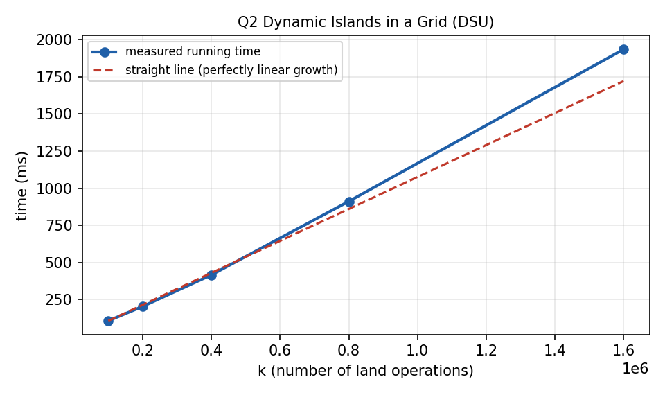

# Q2. Dynamic Connected Components in a Grid (Number of Islands II)

## 1. Problem Title

**Dynamic Connected Components in a Grid (Number of Islands II)**

---

## 2. Problem Statement

An `R × C` grid is initially completely water. Land cells are added one by one at positions `(r1, c1), (r2, c2), …, (rk, ck)`. After **every** operation the program must print the current number of 4-directionally connected land components (islands).

### Modelling assumptions

- Rows and columns are numbered from `0` (`0 ≤ r < R`, `0 ≤ c < C`), as in the standard Number of Islands II problem.
- Connectivity is 4-directional: up, down, left, right (diagonals do not connect).
- If a cell that is already land is added again, nothing changes and the island count is printed again.
- A position outside the grid is reported and ignored.

---

## 3. Input Representation

The grid is never stored as a 2-D matrix of characters. Every cell `(r, c)` is **flattened** into a single number:

```text
id = r * C + c          (and back:  r = id / C,  c = id % C)
```

A single integer array `parent[0 .. R*C-1]` represents the whole grid and the DSU at the same time:

- `parent[id] = -1` means the cell is **water**;
- otherwise the cell is **land** and `parent[id]` is its DSU parent (`parent[id] == id` for a root).
- `sz[id]` stores the size of the tree whose root is `id` (union by size).

The input is one line `R C K` followed by `K` lines `r c`:

```text
R C K
r1 c1
r2 c2
...
rK cK
```

---

## 4. Possible Approaches

### Approach 1: BFS/DFS after every operation

Count the islands from scratch after each new land cell. It costs `O(R·C)` per operation, so `O(k · R · C)` overall: far too slow for large grids.

### Approach 2: DSU with coordinate flattening (used here)

Adding a land cell can only create a new island and merge it with at most four neighbouring islands. DSU handles exactly these operations (make-set and union) in almost constant time.

---

## 5. Basic Idea

Maintain a counter `islands`. When a cell `(r, c)` becomes land:

1. If it is already land, do nothing.
2. Make it a new DSU set and do `islands++` (a new island is born).
3. For each of the four neighbours that is land, `unite` the two cells. Every time two **different** sets are merged, do `islands--`.

The counter is therefore always correct and no recounting is needed.

---

## 6. Step-by-Step Algorithm

1. Read `R`, `C`, `K`. Allocate `parent` and `sz` of size `R·C`; set every `parent[i] = -1`; `islands = 0`.
2. For each operation read `(r, c)`; if it is outside the grid, report and skip.
3. Let `id = r*C + c`. If `parent[id] != -1`, the cell is already land: print the unchanged count.
4. Otherwise set `parent[id] = id`, `sz[id] = 1` and `islands++`.
5. For each of the four neighbours inside the grid that is land: if `unite(id, neighbour)` merged two different sets, do `islands--`.
6. Print the current `islands`.
7. After all operations print the final grid (if it is small enough).

---

## 7. C Program

The complete program is in `Q2.c`. Prompts are written to `stderr` and results to `stdout`.

```c
#include <stdio.h>
#include <stdlib.h>

/*
   Dynamic connected components in a grid (Number of Islands II).
   Cell (r,c) is flattened to id = r*C + c.
   parent[id] = -1  -> the cell is water
   otherwise it is a land cell inside a DSU tree.
*/

int R, C, K;
int *parent, *sz;
int islands = 0;

int find(int x)
{
    while (parent[x] != x)
    {
        parent[x] = parent[parent[x]];   /* path halving */
        x = parent[x];
    }
    return x;
}

/* Merge the sets of a and b; returns 1 if they were different */
int unite(int a, int b)
{
    int ra = find(a), rb = find(b);
    if (ra == rb)
        return 0;
    if (sz[ra] < sz[rb])
    {
        int t = ra; ra = rb; rb = t;
    }
    parent[rb] = ra;
    sz[ra] += sz[rb];
    return 1;
}

/* Turn cell (r,c) into land. Returns 0 if it was already land. */
int addLand(int r, int c)
{
    int id = r * C + c, d;
    int dr[4] = {-1, 1, 0, 0};
    int dc[4] = {0, 0, -1, 1};

    if (parent[id] != -1)
        return 0;

    parent[id] = id;
    sz[id] = 1;
    islands++;                           /* a new island is born */

    for (d = 0; d < 4; d++)
    {
        int nr = r + dr[d], nc = c + dc[d];
        if (nr < 0 || nr >= R || nc < 0 || nc >= C)
            continue;
        if (parent[nr * C + nc] == -1)
            continue;                    /* neighbour is water */
        if (unite(id, nr * C + nc))
            islands--;                   /* two islands became one */
    }
    return 1;
}

int main()
{
    int i, r, c;

    fprintf(stderr, "Enter rows R, columns C and number of operations K: ");
    if (scanf("%d %d %d", &R, &C, &K) != 3 || R <= 0 || C <= 0 || K < 0)
    {
        printf("R and C must be positive and K must not be negative.\n");
        return 0;
    }

    parent = (int *)malloc((size_t)R * C * sizeof(int));
    sz     = (int *)calloc((size_t)R * C, sizeof(int));
    if (!parent || !sz)
    {
        printf("Memory allocation failed.\n");
        return 0;
    }
    for (i = 0; i < R * C; i++)
        parent[i] = -1;                  /* whole grid is water */

    fprintf(stderr, "Enter K positions (row col), 0-indexed:\n");
    for (i = 1; i <= K; i++)
    {
        fprintf(stderr, "Operation %d: ", i);
        if (scanf("%d %d", &r, &c) != 2)
        {
            printf("Invalid input.\n");
            return 0;
        }
        if (r < 0 || r >= R || c < 0 || c >= C)
        {
            printf("Operation %d (%d, %d): outside grid, ignored. "
                   "islands = %d\n", i, r, c, islands);
            continue;
        }
        if (!addLand(r, c))
            printf("Operation %d (%d, %d): already land. islands = %d\n",
                   i, r, c, islands);
        else
            printf("Operation %d (%d, %d): islands = %d\n", i, r, c, islands);
    }

    if (R <= 30 && C <= 30)
    {
        printf("\nFinal grid (# = land, . = water):\n");
        for (r = 0; r < R; r++)
        {
            for (c = 0; c < C; c++)
                putchar(parent[r * C + c] == -1 ? '.' : '#');
            putchar('\n');
        }
    }

    free(parent); free(sz);
    return 0;
}
```

---

## 8. Important Functions

### `find(int x)`

Returns the root of `x`, using **path halving** (each visited node is pointed to its grandparent), which gives the same amortised bound as full path compression and is iterative.

### `unite(int a, int b)`

Merges the sets of `a` and `b` by size. Returns `1` if they were in different sets (a merge happened) and `0` otherwise. The return value is what lets the caller decrement `islands` correctly.

### `addLand(int r, int c)`

Turns one cell into land, creates its singleton set, increments `islands` and merges with the up/down/left/right land neighbours. Returns `0` if the cell was already land.

---

## 9. Important Variables

| Variable | Meaning |
|---|---|
| `R`, `C`, `K` | Rows, columns, number of operations |
| `parent[]` | `-1` = water, otherwise DSU parent of a land cell |
| `sz[]` | Size of the tree of each root (union by size) |
| `islands` | Current number of islands |
| `id` | Flattened index `r*C + c` of a cell |
| `dr[]`, `dc[]` | Row/column offsets of the 4 neighbours |

---

## 10. Sample Input

Type the values below (or redirect them from a file). The prompts are printed on the screen while you type; only the raw input is shown here.

```text
3 3 6
0 0
0 1
1 2
2 1
1 1
0 0
```

---

## 11. Sample Output

```text
Operation 1 (0, 0): islands = 1
Operation 2 (0, 1): islands = 1
Operation 3 (1, 2): islands = 2
Operation 4 (2, 1): islands = 3
Operation 5 (1, 1): islands = 1
Operation 6 (0, 0): already land. islands = 1

Final grid (# = land, . = water):
##.
.##
.#.
```

This output was produced by compiling and running the program on the sample input above.

---

## 12. Dry Run

Grid `3 × 3`, `id = r*3 + c`. Operations: `(0,0) (0,1) (1,2) (2,1) (1,1) (0,0)`.

| Op | Cell (id) | Neighbouring land | Effect on `islands` | Count |
|---|---|---|---|---|
| 1 | (0,0)  id 0 | none | +1 | 1 |
| 2 | (0,1)  id 1 | (0,0): merge | +1, −1 | 1 |
| 3 | (1,2)  id 5 | none | +1 | 2 |
| 4 | (2,1)  id 7 | none | +1 | 3 |
| 5 | (1,1)  id 4 | up (0,1), down (2,1), right (1,2): three merges | +1, −1, −1, −1 | 1 |
| 6 | (0,0)  id 0 | already land | none | 1 |

The final grid is:

```text
##.
.##
.#.
```

---

## 13. Complexity Analysis

Let `N = R·C` and let `k` be the number of operations.

| Quantity | Cost |
|---|---|
| Initialisation of `parent` (all water) | `O(N)` |
| One land addition: one make-set + at most 4 `unite` calls | `O(α(N))` amortised |
| All `k` operations | `O(k · α(N))` |
| **Total time** | **`O(R·C + k · α(R·C))`** |
| **Space** | **`O(R·C)`** for `parent` and `sz` |

### How it was derived

An operation touches at most four neighbours, so it performs at most 4 unions, i.e. at most 8 `find` calls plus constant work. With union by size and path halving each `find` is amortised `O(α(N))`. Hence `O(α(N))` per operation and `O(k α(N))` for all operations; the `O(N)` array initialisation is paid once. The naive method costs `O(k·N)`.

If the grid is huge but `k` is small, the flat array can be replaced by a hash map keyed by `id`, giving `O(k)` space.

---

## 14. Complexity Graph

The graph below shows the **measured running time** of the program (best of 3 runs, `gcc -O2`) for increasing input sizes (up to 1.6 million vertices or operations, with as many edges), together with a perfectly linear reference line. The measured times include reading the input with `scanf`, which is itself linear. The curve stays close to the straight line, which agrees with the near-linear bound.



---

## 15. Advantages

1. Each operation is answered in almost constant time.
2. The 1-D flattened array is simple, cache-friendly and holds both the grid and the DSU.
3. Duplicate additions and out-of-range positions are handled safely.
4. No recounting or graph search is needed.

---

## 16. Limitations

1. Only adding land is supported; removing land would need a different technique.
2. The flat array needs `O(R·C)` memory even if very few cells are used.
3. The printed final grid is limited to `30 × 30` to keep the output readable.

---

## 17. Viva Preparation

**Q1. What is coordinate flattening?**

Mapping a 2-D cell `(r, c)` to one integer `r*C + c`, so a 1-D array can store the whole grid and the DSU.

**Q2. Why is DSU suitable here?**

Land is only ever added, so islands only get created or merged, never split; these are exactly make-set and union operations.

**Q3. How is the island count updated?**

+1 for the new land cell, then −1 for every successful merge with a neighbour.

**Q4. Why must `unite` return whether a merge happened?**

Two neighbours may already belong to the same island; the counter must be decremented only for real merges.

**Q5. What does `parent[id] == -1` mean?**

The cell is water.

**Q6. How are duplicate additions handled?**

If `parent[id] != -1` the cell is already land, so nothing changes.

**Q7. Why only 4 neighbours?**

The problem defines connectivity as 4-directional.

**Q8. What is the complexity?**

`O(R·C + k α(R·C))` time and `O(R·C)` space.

**Q9. What is path halving?**

While walking up to the root, each node is pointed to its grandparent. It flattens the tree like path compression and needs only one pass.

**Q10. What is the brute-force complexity?**

`O(k·R·C)` by running BFS/DFS after every operation.

**Q11. How would you reduce memory for a sparse grid?**

Use a hash map from `id` to DSU node instead of an array of size `R·C`.

---

## 18. 1–2 Minute Teacher Explanation

> "Land cells are added to an initially empty grid, and after each addition I must report the number of islands. Since land is never removed, islands can only appear or merge, which is exactly what a disjoint set union does.
>
> I flatten each cell (r, c) to id = r*C + c and keep one array where -1 means water and any other value is the DSU parent. When a cell becomes land I create a new set and increase the island counter. Then I look at the four neighbours; for each land neighbour I call unite, and if it really merged two different islands I decrease the counter.
>
> Because every operation needs at most four unions, each with amortised O(α(RC)) cost, the total time is O(RC + k α(RC)) and the space is O(RC). The naive approach of re-running BFS after each step would cost O(k·R·C)."

---

## 19. How to Compile and Run

Save the program as `Q2.c`.

### GCC (Linux / macOS)

```text
gcc Q2.c -o Q2
./Q2
```

### Windows

```text
gcc Q2.c -o Q2.exe
Q2.exe
```

### Using a file as input

```text
./Q2 < input.txt > output.txt
```

---

## 20. Files in This Lab

1. `Q2.c` — C source code
2. `README.md` — complete explanation and lab documentation
3. `Q2_complexity.png` — measured running-time graph

---

## 21. Conclusion

Number of Islands II is a pure make-set / union workload: land is only added, so islands are created or merged but never split. Flattening coordinates to `r*C + c` lets one array represent both the grid and the DSU, giving `O(R·C + k α(R·C))` time and `O(R·C)` space.
