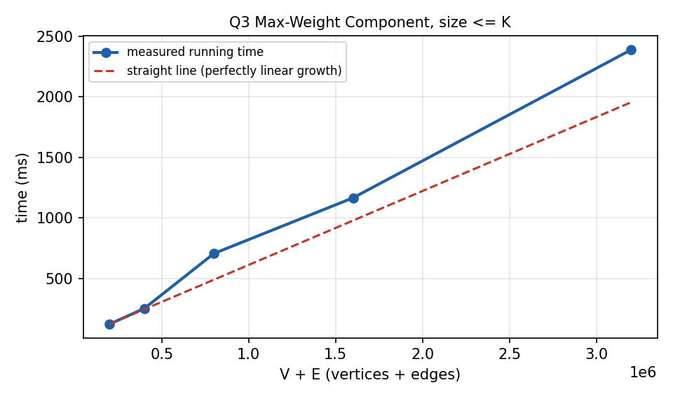

# Q3. Maximum Weight Component with Size Constraint

## 1. Problem Title

**Maximum Weight Component with Size Constraint**

---

## 2. Problem Statement

A graph has `V` vertices, and vertex `v` has weight `wv`. Edges, each with a weight, are added **sequentially**. At any point we must report the maximum total vertex weight of any connected component whose **size** (number of vertices) does not exceed a threshold `K`.

### Modelling assumptions

- The *weight of a component* is the sum of the weights of its **vertices**, as the statement says ("total vertex weight"). The edge weights are read but do not affect the answer.
- The *size* of a component is its number of vertices; a component is **valid** if its size is at most `K` (`K ≥ 1`, so every single vertex is initially valid).
- The answer is printed once before any edge and again after every edge.
- If every component is larger than `K`, the program prints that no valid component exists.
- Vertex weights may be any integers (negative weights are handled too).

---

## 3. Input Representation

Edges arrive online, so no adjacency structure is built. The state of the graph is stored in a DSU where each **root** also keeps aggregate data:

| Array | Meaning |
|---|---|
| `parent[x]` | DSU parent |
| `size_[r]` | number of vertices in the component with root `r` |
| `sum[r]` | total vertex weight of the component with root `r` (`long long`) |
| `heap[]` | max-heap of candidate answers `(weight, root)` |

```text
V K E
w1 w2 ... wV
u1 v1 x1
u2 v2 x2
...
uE vE xE        (xi = edge weight, not used for the answer)
```

---

## 4. Possible Approaches

### Approach 1: Recompute everything after every edge

Run BFS/DFS, find all components and take the maximum valid sum: `O(V + E)` per edge, `O(E(V+E))` overall.

### Approach 2: DSU + scan of all roots

DSU maintains `size` and `sum` in near-constant time, but finding the maximum over all roots after each edge costs `O(V)`, giving `O(E · V)`.

### Approach 3: DSU + max-heap with lazy deletion (used here)

The difficulty is that the answer can **decrease**: when the best component merges into another one and becomes larger than `K`, it disappears. A plain running maximum cannot handle that. A max-heap handles it if stale entries are discarded lazily when they reach the top.

---

## 5. Basic Idea

Components only ever **grow** when edges are added. Therefore a component that has become larger than `K` can never become valid again, and the only way a valid candidate disappears is by being merged into a bigger set.

- Whenever a merge creates a component of size `≤ K`, push `(sum, root)` into the max-heap.
- Old entries are never removed immediately. Instead, when answering, look at the top entry and test whether it is **still valid**:

```text
entry (w, r) is valid  <=>  r is still a DSU root  AND  sum[r] == w  AND  size_[r] <= K
```

If the top is stale, pop it and look again. The first valid top is the maximum weight among all currently valid components, because every currently valid component has a (non-stale) entry in the heap.

---

## 6. Step-by-Step Algorithm

1. Read `V`, `K`, `E` and the vertex weights. Initialise each vertex as its own set: `size_ = 1`, `sum = weight`; push every `(weight, vertex)` into the heap (all are valid because `K ≥ 1`).
2. Report the answer for the initial graph.
3. For each edge `(u, v)`: find both roots; if they are equal, nothing changes.
4. Otherwise union by size, update `size_` and `sum` of the new root, and if the new size is `≤ K` push `(sum, root)` into the heap.
5. To report: while the heap is non-empty and its top is stale, pop it.
6. If the heap is empty, print that no component has size `≤ K`; otherwise print the top weight and the size of its component.

---

## 7. C Program

The complete program is in `Q3.c`. Prompts are written to `stderr` and results to `stdout`.

```c
#include <stdio.h>
#include <stdlib.h>

/*
   Maximum weight component with size <= K, edges arriving online.

   DSU keeps for every root: size_[] and sum[] (total vertex weight).
   A max-heap with LAZY DELETION keeps candidate (sum, root) pairs.
   A heap entry is valid only if
        root is still a DSU root, sum[root] == entry.w, size_[root] <= K.
*/

typedef long long ll;

typedef struct { ll w; int root; } Entry;

int V, K, E;
int *parent, *size_;
ll *sum, *weight;

Entry *heap;
int heapSize = 0;

/* ---------- max-heap on Entry.w ---------- */
void heapPush(ll w, int root)
{
    int i = heapSize++;
    while (i > 0 && heap[(i - 1) / 2].w < w)
    {
        heap[i] = heap[(i - 1) / 2];
        i = (i - 1) / 2;
    }
    heap[i].w = w;
    heap[i].root = root;
}

void heapPop()
{
    Entry last = heap[--heapSize];
    int i = 0, child;
    while ((child = 2 * i + 1) < heapSize)
    {
        if (child + 1 < heapSize && heap[child + 1].w > heap[child].w)
            child++;
        if (heap[child].w <= last.w)
            break;
        heap[i] = heap[child];
        i = child;
    }
    if (heapSize > 0)
        heap[i] = last;
}

/* ---------- DSU ---------- */
int find(int x)
{
    while (parent[x] != x)
    {
        parent[x] = parent[parent[x]];
        x = parent[x];
    }
    return x;
}

int isValid(Entry e)
{
    return parent[e.root] == e.root && sum[e.root] == e.w
           && size_[e.root] <= K;
}

void addEdge(int u, int v)
{
    int ru = find(u), rv = find(v);
    if (ru == rv)
        return;
    if (size_[ru] < size_[rv])
    {
        int t = ru; ru = rv; rv = t;
    }
    parent[rv] = ru;
    size_[ru] += size_[rv];
    sum[ru] += sum[rv];
    if (size_[ru] <= K)          /* only a valid component is a candidate */
        heapPush(sum[ru], ru);
}

/* Prints the current answer; removes stale entries from the heap top */
void report(const char *label, int idx)
{
    while (heapSize > 0 && !isValid(heap[0]))
        heapPop();

    if (heapSize == 0)
        printf("%s %d: no component has size <= K\n", label, idx);
    else
        printf("%s %d: maximum weight = %lld (component size %d)\n",
               label, idx, heap[0].w, size_[heap[0].root]);
}

int main()
{
    int i, u, v;
    ll w;

    fprintf(stderr, "Enter V, K and E: ");
    if (scanf("%d %d %d", &V, &K, &E) != 3 || V <= 0 || K <= 0 || E < 0)
    {
        printf("V and K must be positive and E must not be negative.\n");
        return 0;
    }

    parent = (int *)malloc((V + 1) * sizeof(int));
    size_  = (int *)malloc((V + 1) * sizeof(int));
    sum    = (ll *)malloc((V + 1) * sizeof(ll));
    weight = (ll *)malloc((V + 1) * sizeof(ll));
    /* V initial entries + at most V-1 successful unions -> fewer than 2V entries */
    heap   = (Entry *)malloc((size_t)(2 * V + 2) * sizeof(Entry));
    if (!parent || !size_ || !sum || !weight || !heap)
    {
        printf("Memory allocation failed.\n");
        return 0;
    }

    fprintf(stderr, "Enter the %d vertex weights: ", V);
    for (i = 1; i <= V; i++)
    {
        if (scanf("%lld", &weight[i]) != 1)
        {
            printf("Invalid input.\n");
            return 0;
        }
        parent[i] = i;
        size_[i] = 1;
        sum[i] = weight[i];
        heapPush(sum[i], i);     /* every singleton is valid since K >= 1 */
    }

    report("Initially, before edge", 0);

    fprintf(stderr, "Enter the %d edges (u v edgeWeight):\n", E);
    for (i = 1; i <= E; i++)
    {
        fprintf(stderr, "Edge %d: ", i);
        if (scanf("%d %d %lld", &u, &v, &w) != 3 ||
            u < 1 || u > V || v < 1 || v > V)
        {
            printf("Invalid edge.\n");
            return 0;
        }
        /* The edge weight w does not change vertex weights, so it is not used. */
        addEdge(u, v);
        report("After edge", i);
    }

    free(parent); free(size_); free(sum); free(weight); free(heap);
    return 0;
}
```

---

## 8. Important Functions

### `heapPush(w, root)` / `heapPop()`

A hand-written binary max-heap ordered by `w`. Both operations cost `O(log n)` for a heap of `n` entries.

### `find(int x)`

Iterative DSU find with path halving.

### `isValid(Entry e)`

Decides whether a heap entry still describes a real, currently valid component (still a root, same sum, size at most `K`).

### `addEdge(int u, int v)`

Merges the components of `u` and `v` (if different), updates `size_` and `sum`, and pushes the new candidate if its size is at most `K`.

### `report(label, idx)`

Discards stale entries from the top of the heap and prints the current maximum valid component weight.

---

## 9. Important Variables

| Variable | Meaning |
|---|---|
| `V`, `K`, `E` | Number of vertices, size limit, number of edges |
| `weight[]` | Vertex weights |
| `parent[]`, `size_[]` | DSU parent and component size |
| `sum[]` | Total vertex weight of each component (valid at roots) |
| `heap[]`, `heapSize` | Max-heap of `(weight, root)` candidates |
| `Entry` | Structure `{ long long w; int root; }` |

---

## 10. Sample Input

Type the values below (or redirect them from a file). The prompts are printed on the screen while you type; only the raw input is shown here.

```text
6 3 5
5 1 4 7 2 3
1 2 10
3 4 20
2 3 5
5 6 7
1 5 2
```

---

## 11. Sample Output

```text
Initially, before edge 0: maximum weight = 7 (component size 1)
After edge 1: maximum weight = 7 (component size 1)
After edge 2: maximum weight = 11 (component size 2)
After edge 3: maximum weight = 3 (component size 1)
After edge 4: maximum weight = 5 (component size 2)
After edge 5: no component has size <= K
```

This output was produced by compiling and running the program on the sample input above.

---

## 12. Dry Run

`V = 6`, `K = 3`, weights `[5, 1, 4, 7, 2, 3]`. Heap initially holds the six singletons.

| Step | Components (weight) | Heap action | Answer |
|---|---|---|---|
| start | {1}=5 {2}=1 {3}=4 {4}=7 {5}=2 {6}=3 | 6 pushes | 7 |
| edge (1,2) | {1,2}=6 {3} {4}=7 {5} {6} | push 6; entries 5 and 1 become stale | 7 |
| edge (3,4) | {1,2}=6 {3,4}=11 {5} {6} | push 11 | 11 |
| edge (2,3) | {1,2,3,4} has size 4 > K (invalid), {5}=2, {6}=3 | no push; stale entries 11, 7, 6, 5, 4 are popped from the top | 3 |
| edge (5,6) | {1,2,3,4} (invalid) {5,6}=5 | push 5 | 5 |
| edge (1,5) | everything merged, size 6 > K | no push; all entries stale | no valid component |

The answers printed by the program are `7, 7, 11, 3, 5, none` (the first 7 is before any edge). After edge 3 the answer **decreases** from 11 to 3, which is exactly the situation that requires the heap with lazy deletion.

---

## 13. Complexity Analysis

Heap entries are pushed only for the `V` initial vertices and for **successful** unions. There are at most `V − 1` successful unions, so the heap never holds more than `2V − 1` entries, and every entry is popped at most once.

| Quantity | Cost |
|---|---|
| Initialisation (V pushes) | `O(V log V)` |
| `E` edges: DSU work | `O(E · α(V))` |
| Pushes caused by merges (≤ V−1) | `O(V log V)` |
| Pops of stale entries (each entry popped at most once) | `O(V log V)` in total |
| Reading the top for each report | `O(1)` per edge |
| **Total time** | **`O(E · α(V) + V log V)`** |
| **Space** | **`O(V)`** |

### How it was derived

Each edge costs two `find` calls (`O(α(V))` amortised) and at most one push (`O(log V)`), but the number of pushes over the whole run is bounded by `2V − 1`, not by `E`. Stale entries are removed at most once each, so the total pop cost is also `O(V log V)`. Adding the parts gives `O(E α(V) + V log V)`. The simple alternatives cost `O(E · V)`.

---

## 14. Complexity Graph

The graph below shows the **measured running time** of the program (best of 3 runs, `gcc -O2`) for increasing input sizes (up to 1.6 million vertices or operations, with as many edges), together with a perfectly linear reference line. The measured times include reading the input with `scanf`, which is itself linear. The curve stays close to the straight line, which agrees with the near-linear bound.



---

## 15. Advantages

1. Correct even when the answer decreases (when the best component becomes too large).
2. Near-linear overall running time, much better than rescanning all components.
3. Works with negative vertex weights as well.
4. Uses only `O(V)` memory.

---

## 16. Limitations

1. Edges can only be added, not removed.
2. The edge weights are ignored because the objective depends only on vertex weights.
3. Weights are limited to the range of `long long`.
4. Component size is counted in vertices (not edges).

---

## 17. Viva Preparation

**Q1. What does the DSU store in addition to parents?**

For every root: the component size and the total vertex weight.

**Q2. Why is a simple running maximum not enough?**

A component that was the maximum can merge into a component larger than `K` and disappear, so the maximum can decrease.

**Q3. What is lazy deletion?**

Instead of deleting outdated heap entries immediately, we leave them and discard them when they reach the top and are found to be stale.

**Q4. When is a heap entry `(w, r)` valid?**

When `r` is still a root, `sum[r] == w` and `size_[r] <= K`.

**Q5. Why can a component never become valid again once it is larger than `K`?**

Components only grow when edges are added.

**Q6. Why do we push only if the new size is at most `K`?**

A component larger than `K` can never be an answer, so it is useless in the heap.

**Q7. Why is the heap size at most `2V − 1`?**

V initial pushes plus at most V−1 successful unions.

**Q8. What is the total complexity?**

`O(E α(V) + V log V)` time and `O(V)` space.

**Q9. What happens if the edge joins two vertices already in the same component?**

Nothing changes, so the previous answer remains valid.

**Q10. What is the role of the edge weights?**

None for this objective; they are read and ignored because only vertex weights are summed.

**Q11. Why use `long long`?**

Sums of many large vertex weights can overflow `int`.

---

## 18. 1–2 Minute Teacher Explanation

> "I use a DSU in which every root stores the component size and total vertex weight. When an edge connects two different components I merge them and add their sizes and weights.
>
> The tricky part is the query, because the answer can go down: if the best component merges into one that becomes larger than K, it is no longer allowed. So I keep a max-heap of candidate (weight, root) pairs and I push a new pair whenever a merge produces a component of size at most K. I never delete old pairs immediately; at query time I look at the top and check that its root is still a root, that its stored weight equals the current weight and that the size is still at most K. If not, I discard it and look at the next one.
>
> There are at most 2V entries because pushes come only from the V initial vertices and at most V-1 merges, and each entry is popped at most once. So the total time is O(E α(V) + V log V) and the space is O(V)."

---

## 19. How to Compile and Run

Save the program as `Q3.c`.

### GCC (Linux / macOS)

```text
gcc Q3.c -o Q3
./Q3
```

### Windows

```text
gcc Q3.c -o Q3.exe
Q3.exe
```

### Using a file as input

```text
./Q3 < input.txt > output.txt
```

---

## 20. Files in This Lab

1. `Q3.c` — C source code
2. `README.md` — complete explanation and lab documentation
3. `Q3_complexity.png` — measured running-time graph

---

## 21. Conclusion

The only subtle point is that the best valid component can disappear when it merges into a component larger than `K`. A DSU that maintains size and weight, combined with a max-heap using lazy deletion, handles this and gives `O(E α(V) + V log V)` time and `O(V)` space.
