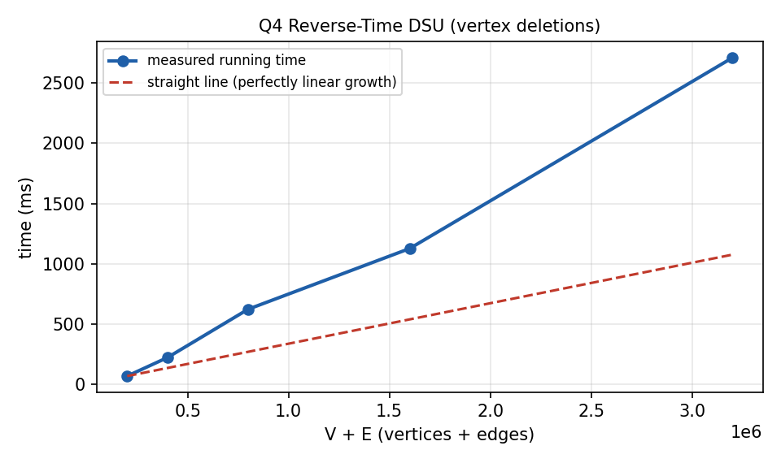

# Q4. Reverse Time-Step DSU: Maximum Component Sum under Vertex Deletions

## 1. Problem Title

**Reverse Time-Step DSU: Maximum Component Sum under Vertex Deletions**

---

## 2. Problem Statement

A vertex-weighted undirected graph is given. Vertices are deleted one by one in the order `P = [p1, p2, …, pV]`. Deleting a vertex removes it **and all its incident edges**. After each deletion we must output the maximum sum of vertex values among all remaining connected components.

### Modelling assumptions

- Vertices are numbered `1..V` and `P` is a permutation of `1..V`.
- Vertex values are **non-negative** integers (the standard assumption for this problem; it makes the component sum behave monotonically when components are merged).
- After the last deletion the graph is empty, so the answer is `0`.
- Self-loops and parallel edges are allowed and cause no problems.
- The program additionally prints the answer *before* any deletion.

---

## 3. Input Representation

This problem needs to know the neighbours of a vertex at the moment that vertex is (re)inserted, so the graph is stored as an **adjacency list implemented with arrays** (forward-star / linked-list-in-arrays), which uses `O(V + E)` memory and no pointer allocation:

| Array | Meaning |
|---|---|
| `head[v]` | index of the first edge of vertex `v` (`-1` if none) |
| `to[e]`, `nxt[e]` | the other end of edge `e` and the next edge of the same vertex |
| `weight[v]` | value of vertex `v` |
| `P[i]` | the i-th vertex to be deleted |
| `active[v]` | 1 if `v` is currently present in the reverse process |
| `parent`, `size_`, `sum` | DSU arrays; `sum[r]` is the total value of the component of root `r` |

```text
V E
w1 w2 ... wV
u1 v1
...
uE vE
p1 p2 ... pV
```

---

## 4. Possible Approaches

### Approach 1: Recompute after every deletion

Delete the vertex, run BFS/DFS and take the maximum component sum: `O(V + E)` per deletion, `O(V(V + E))` in total.

### Approach 2: Forward DSU

DSU supports only *merging*; it cannot split a set when a vertex is removed, so it cannot be applied directly to deletions.

### Approach 3: Reverse time with DSU (used here)

Run the process **backwards**: deletions become insertions, and insertions only merge components, which DSU does perfectly.

---

## 5. Basic Idea

Let `ans[i]` be the answer after deleting `p1, …, pi`. This is the best component sum of the graph induced by the vertices `p(i+1), …, pV`. So if we start with an **empty graph** and insert `pV`, then `p(V−1)`, …, then `p1`, the graph just before inserting `p_i` is exactly the graph remaining after the i-th deletion.

Insertion of a vertex `x`:

1. create the set `{x}` with sum `weight[x]`;
2. for every neighbour `u` of `x` that is already present, merge the components of `x` and `u`;
3. maintain `best`, the maximum component sum so far.

Because vertex values are non-negative, merging never decreases a component's sum, so a single running maximum `best` is enough (in the reverse process components only grow).

```text
for i = V down to 0:
    ans[i] = best            // graph = {p(i+1), ..., pV}
    if i > 0: insert p_i and update best
```

---

## 6. Step-by-Step Algorithm

1. Read the graph, the vertex values and the deletion order `P`; build the adjacency lists (each edge stored in both directions).
2. Set `best = 0` and `active[·] = 0`.
3. For `i = V` down to `0`: set `ans[i] = best`.
4. If `i > 0`, insert `p_i`: make it a singleton set, update `best` with its weight.
5. For each neighbour `u` of `p_i` with `active[u] = 1`: if `find(p_i) != find(u)` merge them, add the sums and update `best`.
6. Print `ans[0]` (before any deletion) and then `ans[1..V]` in deletion order.

---

## 7. C Program

The complete program is in `Q4.c`. Prompts are written to `stderr` and results to `stdout`.

```c
#include <stdio.h>
#include <stdlib.h>

/*
   Reverse time-step DSU.
   Deleting vertices p1..pV one by one is hard for DSU (it cannot split sets),
   so we run time backwards: start with an empty graph and ADD
   pV, pV-1, ..., p1 and record the best component sum before each addition.
*/

typedef long long ll;

int V, E;
int *head, *nxt, *to;          /* adjacency list stored in arrays */
int *parent, *size_, *active;
ll *weight, *sum, *ans;
int *P;

int find(int x)
{
    while (parent[x] != x)
    {
        parent[x] = parent[parent[x]];
        x = parent[x];
    }
    return x;
}

void addEdgeToList(int a, int b, int *cnt)
{
    to[*cnt] = b;
    nxt[*cnt] = head[a];
    head[a] = (*cnt)++;
}

int main()
{
    int i, a, b, cnt = 0, e;
    ll best = 0;

    fprintf(stderr, "Enter number of vertices V and edges E: ");
    if (scanf("%d %d", &V, &E) != 2 || V <= 0 || E < 0)
    {
        printf("V must be positive and E must not be negative.\n");
        return 0;
    }

    head   = (int *)malloc((V + 1) * sizeof(int));
    nxt    = (int *)malloc((size_t)(2 * E + 1) * sizeof(int));
    to     = (int *)malloc((size_t)(2 * E + 1) * sizeof(int));
    parent = (int *)malloc((V + 1) * sizeof(int));
    size_  = (int *)malloc((V + 1) * sizeof(int));
    active = (int *)calloc(V + 1, sizeof(int));
    weight = (ll *)malloc((V + 1) * sizeof(ll));
    sum    = (ll *)malloc((V + 1) * sizeof(ll));
    ans    = (ll *)malloc((V + 2) * sizeof(ll));
    P      = (int *)malloc((V + 1) * sizeof(int));
    if (!head || !nxt || !to || !parent || !size_ || !active ||
        !weight || !sum || !ans || !P)
    {
        printf("Memory allocation failed.\n");
        return 0;
    }
    for (i = 1; i <= V; i++)
        head[i] = -1;

    fprintf(stderr, "Enter the %d vertex values (non-negative): ", V);
    for (i = 1; i <= V; i++)
    {
        if (scanf("%lld", &weight[i]) != 1 || weight[i] < 0)
        {
            printf("Vertex values must be non-negative integers.\n");
            return 0;
        }
    }

    fprintf(stderr, "Enter the %d edges (u v):\n", E);
    for (i = 1; i <= E; i++)
    {
        if (scanf("%d %d", &a, &b) != 2 || a < 1 || a > V || b < 1 || b > V)
        {
            printf("Invalid edge.\n");
            return 0;
        }
        addEdgeToList(a, b, &cnt);
        addEdgeToList(b, a, &cnt);
    }

    fprintf(stderr, "Enter the deletion order P (a permutation of 1..%d): ", V);
    for (i = 1; i <= V; i++)
    {
        if (scanf("%d", &P[i]) != 1 || P[i] < 1 || P[i] > V || active[P[i]])
        {
            printf("P must be a permutation of 1..%d.\n", V);
            return 0;
        }
        active[P[i]] = 1;        /* temporarily used as a "seen" flag */
    }
    for (i = 1; i <= V; i++)
        active[i] = 0;

    /* ---- reverse process ---- */
    for (i = V; i >= 0; i--)
    {
        ans[i] = best;           /* best sum after deleting p1..pi */
        if (i == 0)
            break;

        a = P[i];                /* re-insert vertex p_i */
        active[a] = 1;
        parent[a] = a;
        size_[a] = 1;
        sum[a] = weight[a];
        if (sum[a] > best)
            best = sum[a];

        for (e = head[a]; e != -1; e = nxt[e])
        {
            int u = to[e];
            int ra, rb;
            if (!active[u])
                continue;
            ra = find(a);
            rb = find(u);
            if (ra == rb)
                continue;
            if (size_[ra] < size_[rb])
            {
                int t = ra; ra = rb; rb = t;
            }
            parent[rb] = ra;
            size_[ra] += size_[rb];
            sum[ra] += sum[rb];
            if (sum[ra] > best)
                best = sum[ra];
        }
    }

    printf("Before any deletion: maximum component sum = %lld\n", ans[0]);
    for (i = 1; i <= V; i++)
        printf("After deleting vertex %d: maximum component sum = %lld\n",
               P[i], ans[i]);

    return 0;
}
```

---

## 8. Important Functions

### `addEdgeToList(a, b, &cnt)`

Inserts the directed edge `a → b` at the front of the list of `a` (called twice per undirected edge).

### `find(int x)`

Iterative DSU find with path halving.

### `main()`

Reads and validates the input (including that `P` is a permutation), runs the reverse insertion loop with DSU merges, and prints the answers in the original deletion order.

---

## 9. Important Variables

| Variable | Meaning |
|---|---|
| `V`, `E` | Number of vertices and edges |
| `weight[]` | Vertex values |
| `head[]`, `nxt[]`, `to[]` | Adjacency list stored in arrays |
| `P[]` | Deletion order |
| `active[]` | Whether a vertex has been re-inserted |
| `parent[]`, `size_[]`, `sum[]` | DSU arrays with component sums |
| `best` | Maximum component sum currently present |
| `ans[]` | `ans[i]` = answer after i deletions |

---

## 10. Sample Input

Type the values below (or redirect them from a file). The prompts are printed on the screen while you type; only the raw input is shown here.

```text
5 4
4 2 7 3 5
1 2
2 3
3 4
4 5
3 1 5 2 4
```

---

## 11. Sample Output

```text
Before any deletion: maximum component sum = 21
After deleting vertex 3: maximum component sum = 8
After deleting vertex 1: maximum component sum = 8
After deleting vertex 5: maximum component sum = 3
After deleting vertex 2: maximum component sum = 3
After deleting vertex 4: maximum component sum = 0
```

This output was produced by compiling and running the program on the sample input above.

---

## 12. Dry Run

Path graph `1 – 2 – 3 – 4 – 5` with values `[4, 2, 7, 3, 5]` (total 21) and deletion order `P = [3, 1, 5, 2, 4]`. We process the order in reverse.

| i | `ans[i]` stored (current `best`) | Insert `p_i` | Components now | `best` |
|---|---|---|---|---|
| 5 | 0 | 4 (value 3) | {4}=3 | 3 |
| 4 | 3 | 2 (value 2) | {4}=3, {2}=2 | 3 |
| 3 | 3 | 5 (value 5), merges with 4 | {4,5}=8, {2}=2 | 8 |
| 2 | 8 | 1 (value 4), merges with 2 | {1,2}=6, {4,5}=8 | 8 |
| 1 | 8 | 3 (value 7), merges with 2 and 4 | {1,2,3,4,5}=21 | 21 |
| 0 | 21 | — | — | — |

Reading `ans[1..5]` forwards: `8, 8, 3, 3, 0`, with `ans[0] = 21` before any deletion. Check by hand: deleting vertex 3 leaves `{1,2} = 6` and `{4,5} = 8`, so the answer is 8. ✓

---

## 13. Complexity Analysis

| Quantity | Cost |
|---|---|
| Building the adjacency lists | `O(V + E)` |
| Reverse loop: every vertex is inserted once | `O(V)` |
| Every edge is examined exactly twice (once from each end), each time with ≤ 2 `find` calls | `O(E · α(V))` |
| **Total time** | **`O(V + E · α(V))`**, practically linear |
| **Space** | **`O(V + E)`** |

### How it was derived

In the reverse process each vertex is activated once, and while activating it we walk through its adjacency list. Summed over all vertices, the lists have total length `2E`. For each entry we do at most two `find` calls, each amortised `O(α(V))` with union by size and path halving. Therefore the whole run takes `O(V + E α(V))`. The naive recomputation costs `O(V(V + E))`.

---

## 14. Complexity Graph

The graph below shows the **measured running time** of the program (best of 3 runs, `gcc -O2`) for increasing input sizes (up to 1.6 million vertices or operations, with as many edges), together with a perfectly linear reference line. The measured times include reading the input with `scanf`, which is itself linear. The curve stays close to the straight line, which agrees with the near-linear bound.



---

## 15. Advantages

1. Converts a hard deletion problem into an easy insertion problem.
2. Near-linear time: every vertex and edge is handled a constant number of times.
3. A single `best` variable is enough because components only grow in reverse.
4. Handles self-loops and repeated edges without special code.

---

## 16. Limitations

1. The whole deletion order must be known in advance (the algorithm is offline).
2. It relies on non-negative vertex values; with negative values a single running maximum is not sufficient.
3. The adjacency lists need `O(E)` memory, unlike the online problems.

---

## 17. Viva Preparation

**Q1. Why can't DSU be used directly for deletions?**

DSU supports union but not splitting a set, and deleting a vertex may split a component.

**Q2. What is the trick?**

Reverse time: add the vertices in the reverse order of deletion so that every step is a merge.

**Q3. What does `ans[i]` represent?**

The maximum component sum after the first `i` deletions, i.e. in the graph made of `p(i+1)..pV`.

**Q4. Why is `ans[V] = 0`?**

After deleting all vertices the graph is empty.

**Q5. Why is one `best` variable enough?**

In the reverse process components only grow and values are non-negative, so sums never decrease.

**Q6. Why must vertex values be non-negative?**

With negative values merging could reduce a sum, and the maximum would no longer be monotone.

**Q7. Why store each edge twice?**

The graph is undirected; each vertex needs to see its neighbours when it is inserted.

**Q8. Why check `active[u]`?**

Only neighbours that have already been re-inserted exist in the current graph.

**Q9. What is the time complexity?**

`O(V + E α(V))` with `O(V + E)` space.

**Q10. What is the complexity of the naive method?**

`O(V(V + E))`.

**Q11. Is this algorithm online?**

No, it is offline: it needs the complete deletion order beforehand.

---

## 18. 1–2 Minute Teacher Explanation

> "Deleting vertices splits components, but a DSU can only merge. So I reverse time. The graph that remains after the i-th deletion is made of the vertices p(i+1) to pV, so if I start from an empty graph and add pV, then p(V-1), and so on, then just before adding p_i the graph is exactly what remains after the i-th deletion. I store the current best component sum at that moment as the answer for step i.
>
> To add a vertex I make a new set with its value and merge it with every neighbour that has already been added; each component keeps its total value in the DSU root and I keep one running maximum. Since values are non-negative and components only grow in reverse, the running maximum is correct. Finally I print the stored answers in forward order.
>
> Every vertex is added once and every edge is looked at twice, so the time is O(V + E α(V)) and the space is O(V + E)."

---

## 19. How to Compile and Run

Save the program as `Q4.c`.

### GCC (Linux / macOS)

```text
gcc Q4.c -o Q4
./Q4
```

### Windows

```text
gcc Q4.c -o Q4.exe
Q4.exe
```

### Using a file as input

```text
./Q4 < input.txt > output.txt
```

---

## 20. Files in This Lab

1. `Q4.c` — C source code
2. `README.md` — complete explanation and lab documentation
3. `Q4_complexity.png` — measured running-time graph

---

## 21. Conclusion

Vertex deletion splits components, which DSU cannot do, so the problem is solved backwards: vertices are inserted in reverse order and the best component sum is recorded before each insertion. The time is `O(V + E α(V))` and the space is `O(V + E)`.
