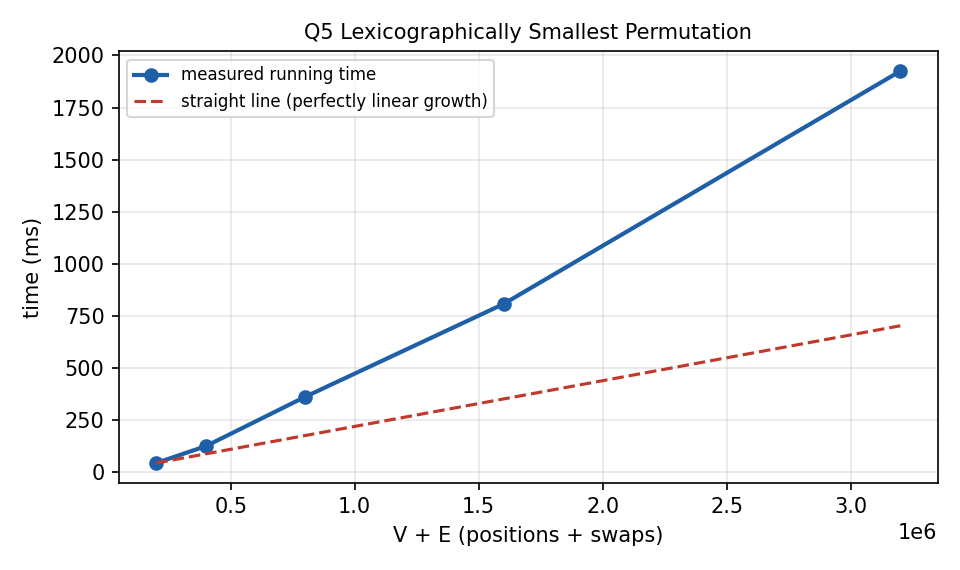

# Q5. Lexicographically Smallest Permutation using Allowed Swaps

## 1. Problem Title

**Lexicographically Smallest Permutation using Allowed Swaps**

---

## 2. Problem Statement

A permutation `A` of the numbers `1..n` is given, together with a list of allowed pairwise swaps `(u, v)` that form the edges of an undirected graph. Any number of the allowed swaps may be performed, in any order, any number of times. Find the **lexicographically smallest** permutation that can be obtained.

### Modelling assumptions

- A swap `(u, v)` exchanges the elements at **positions** `u` and `v` (positions are `1..n`).
- Swaps may be used repeatedly and in any order.
- `A` is validated to be a true permutation of `1..n`.

---

## 3. Input Representation

The graph is on the **positions** `1..n`; its edges are the allowed swaps. The graph itself never has to be stored: it is enough to feed each swap to a DSU. The program stores only arrays of size `n + 2`:

| Array | Meaning |
|---|---|
| `A[i]` | value at position `i` |
| `posOf[v]` | position where value `v` is located |
| `parent`, `size_` | DSU over positions |
| `start`, `grp` | positions of every component laid out contiguously in increasing order (CSR layout) |
| `res[i]` | final answer |

```text
n
A1 A2 ... An
m
u1 v1
...
um vm
```

---

## 4. Possible Approaches

### Approach 1: Greedy swapping

Repeatedly swap any pair where the left element is larger. This can get stuck and is not guaranteed to reach the smallest arrangement, because a useful move may need a chain of swaps through other positions.

### Approach 2: DSU + sorting each component

Find components, collect values and positions of each component, sort both, and assign. Correct, with `O(n log n)` for sorting.

### Approach 3: DSU + counting by values (used here)

Use the same component idea but avoid sorting: go through the values `1, 2, …, n` in increasing order and give each value to the smallest still-free position of its component. Because `A` is a permutation, the values are already available in sorted order, so the running time becomes (almost) linear.

---

## 5. Basic Idea

**Key fact:** if positions are connected by allowed swaps, then the values sitting in these positions can be rearranged in **any** order (any permutation of a connected set of positions can be produced by swaps along the edges of a connected graph, e.g. along a spanning tree). Therefore:

1. positions in different components never exchange values;
2. inside one component the values can be arranged freely.

To obtain the lexicographically smallest result, inside every component place the **smallest values at the smallest positions**. Since each component can be optimised independently and the smallest position overall always gets the smallest value its component owns, this is globally optimal.

---

## 6. Step-by-Step Algorithm

1. Read `n` and `A`; record `posOf[A[i]] = i`; make every position a DSU singleton.
2. For every allowed swap `(u, v)` do `unite(u, v)`.
3. Group positions by root. Counting positions per root and prefix-summing gives the start of each group in `grp[]`; scanning positions `i = 1..n` in order and appending `i` to the group of `find(i)` keeps every group in **increasing** position order.
4. For `v = 1, 2, …, n` in this order: `r = find(posOf[v])`; place `v` at the next unused slot of group `r` (`res[grp[ptr[r]++]] = v`).
5. Print `res[1..n]`.

---

## 7. C Program

The complete program is in `Q5.c`. Prompts are written to `stderr` and results to `stdout`.

```c
#include <stdio.h>
#include <stdlib.h>

/*
   Lexicographically smallest permutation using allowed swaps.
   Positions that are connected by swaps form a component, and inside a
   component the values can be arranged in ANY order. So the smallest
   values of a component must go to its smallest positions.
*/

int n, m;
int *parent, *size_;

int find(int x)
{
    while (parent[x] != x)
    {
        parent[x] = parent[parent[x]];
        x = parent[x];
    }
    return x;
}

void unite(int a, int b)
{
    int ra = find(a), rb = find(b);
    if (ra == rb)
        return;
    if (size_[ra] < size_[rb])
    {
        int t = ra; ra = rb; rb = t;
    }
    parent[rb] = ra;
    size_[ra] += size_[rb];
}

int main()
{
    int i, u, v;
    int *A, *posOf, *start, *ptr, *grp, *res;

    fprintf(stderr, "Enter n: ");
    if (scanf("%d", &n) != 1 || n <= 0)
    {
        printf("n must be positive.\n");
        return 0;
    }

    A      = (int *)malloc((n + 2) * sizeof(int));
    posOf  = (int *)calloc(n + 2, sizeof(int));
    parent = (int *)malloc((n + 2) * sizeof(int));
    size_  = (int *)malloc((n + 2) * sizeof(int));
    start  = (int *)calloc(n + 2, sizeof(int));
    ptr    = (int *)calloc(n + 2, sizeof(int));
    grp    = (int *)malloc((n + 2) * sizeof(int));
    res    = (int *)malloc((n + 2) * sizeof(int));
    if (!A || !posOf || !parent || !size_ || !start || !ptr || !grp || !res)
    {
        printf("Memory allocation failed.\n");
        return 0;
    }

    fprintf(stderr, "Enter the permutation A[1..%d]: ", n);
    for (i = 1; i <= n; i++)
    {
        if (scanf("%d", &A[i]) != 1 || A[i] < 1 || A[i] > n || posOf[A[i]])
        {
            printf("A must be a permutation of 1..%d.\n", n);
            return 0;
        }
        posOf[A[i]] = i;
        parent[i] = i;
        size_[i] = 1;
    }

    fprintf(stderr, "Enter number of allowed swaps m: ");
    if (scanf("%d", &m) != 1 || m < 0)
    {
        printf("m must not be negative.\n");
        return 0;
    }

    fprintf(stderr, "Enter the %d swaps (u v), positions are 1..%d:\n", m, n);
    for (i = 1; i <= m; i++)
    {
        if (scanf("%d %d", &u, &v) != 2 || u < 1 || u > n || v < 1 || v > n)
        {
            printf("Invalid swap.\n");
            return 0;
        }
        unite(u, v);
    }

    /* Group the positions of every component in increasing order (CSR layout):
       start[r] = first slot of root r inside grp[] */
    for (i = 1; i <= n; i++)
        start[find(i) + 1]++;
    for (i = 1; i <= n + 1; i++)
        start[i] += start[i - 1];
    for (i = 1; i <= n; i++)
        ptr[i] = start[i];
    for (i = 1; i <= n; i++)
    {
        int r = find(i);
        grp[ptr[r]++] = i;       /* positions arrive in increasing order */
    }
    for (i = 1; i <= n; i++)
        ptr[i] = start[i];

    /* Give values 1,2,3,... to the smallest free position of their component */
    for (v = 1; v <= n; v++)
    {
        int r = find(posOf[v]);
        res[grp[ptr[r]++]] = v;
    }

    printf("Lexicographically smallest permutation:\n");
    for (i = 1; i <= n; i++)
        printf("%d%c", res[i], i == n ? '\n' : ' ');

    return 0;
}
```

---

## 8. Important Functions

### `find(int x)` and `unite(int a, int b)`

Standard DSU operations: iterative `find` with path halving, and `unite` by size.

### `main()`

Reads and validates input, unites positions, builds the contiguous groups, then fills `res[]` by giving every value, in increasing order, the smallest free position of its component. `ptr[r]` is the next free slot in group `r`.

---

## 9. Important Variables

| Variable | Meaning |
|---|---|
| `n`, `m` | Permutation length and number of allowed swaps |
| `A[]` | Input permutation |
| `posOf[]` | Position of each value |
| `parent[]`, `size_[]` | DSU over positions |
| `start[]` | Offset of each component's group in `grp[]` |
| `grp[]` | Positions of all components, grouped, increasing |
| `ptr[]` | Next free slot in each group |
| `res[]` | Resulting smallest permutation |

---

## 10. Sample Input

Type the values below (or redirect them from a file). The prompts are printed on the screen while you type; only the raw input is shown here.

```text
6
6 3 5 1 4 2
3
1 2
2 4
3 5
```

---

## 11. Sample Output

```text
Lexicographically smallest permutation:
1 3 4 6 5 2
```

This output was produced by compiling and running the program on the sample input above.

---

## 12. Dry Run

`n = 6`, `A = [6, 3, 5, 1, 4, 2]`, swaps `(1,2)`, `(2,4)`, `(3,5)`.

| Component (positions) | Values currently there | Positions sorted | Values sorted | Result |
|---|---|---|---|---|
| {1, 2, 4} | 6, 3, 1 | 1, 2, 4 | 1, 3, 6 | pos 1 = 1, pos 2 = 3, pos 4 = 6 |
| {3, 5} | 5, 4 | 3, 5 | 4, 5 | pos 3 = 4, pos 5 = 5 |
| {6} | 2 | 6 | 2 | pos 6 = 2 |

Final permutation: `1 3 4 6 5 2`. The program obtains the same result without sorting: value 1 is at position 4 (component {1,2,4}) and gets the smallest free position 1; value 2 (component {6}) gets position 6; value 3 gets position 2; value 4 (component {3,5}) gets position 3; value 5 gets position 5; value 6 gets position 4.

---

## 13. Complexity Analysis

| Quantity | Cost |
|---|---|
| Reading `A` and initialising | `O(n)` |
| `m` unions | `O(m · α(n))` |
| Grouping positions by root (counting sort / CSR) | `O(n · α(n))` |
| Assigning values `1..n` to positions | `O(n · α(n))` |
| **Total time** | **`O(n + m · α(n))`**, practically linear |
| **Space** | **`O(n)`** |

### How it was derived

The DSU phase processes `m` edges at amortised `O(α(n))` each. The grouping and assignment phases each touch every position (or value) a constant number of times, with one `find` per touch. No sorting is needed because values are visited in increasing order `1..n` and positions are collected in increasing order by a single left-to-right scan. If values were not a permutation, sorting inside every component would add `O(n log n)`.

---

## 14. Complexity Graph

The graph below shows the **measured running time** of the program (best of 3 runs, `gcc -O2`) for increasing input sizes (up to 1.6 million vertices or operations, with as many edges), together with a perfectly linear reference line. The measured times include reading the input with `scanf`, which is itself linear. The curve stays close to the straight line, which agrees with the near-linear bound.



---

## 15. Advantages

1. Near-linear time; no sorting step is required.
2. Uses only `O(n)` memory and never stores the swap graph.
3. Provably optimal: components are independent and each is arranged in increasing order.
4. Input validation guarantees `A` really is a permutation.

---

## 16. Limitations

1. Assumes that swaps exchange *positions*; a swap on *values* would need the graph to be built over values instead.
2. The values must form a permutation of `1..n` for the counting-by-value trick; for arbitrary values each component must be sorted.

---

## 17. Viva Preparation

**Q1. Why do connected positions allow any arrangement?**

Adjacent transpositions along a spanning tree of a connected graph generate every permutation of its vertices.

**Q2. Why is DSU used?**

It finds the connected components of the swap graph in almost linear time.

**Q3. What is the greedy rule inside a component?**

Put the smallest values at the smallest positions.

**Q4. Why is this lexicographically smallest overall?**

Components are independent, and in each one the earliest position gets the smallest value that component can supply.

**Q5. Why is sorting not needed in this program?**

Values are processed in increasing order `1..n` and positions are collected in increasing order, so both lists are already sorted.

**Q6. What does `ptr[r]` do?**

It points to the next free (smallest unused) position in the group of root `r`.

**Q7. What is CSR layout?**

Storing all groups one after another in one array with a `start[]` offset for each group.

**Q8. What is the complexity?**

`O(n + m α(n))` time, `O(n)` space.

**Q9. What if no swap is allowed?**

Every position is its own component, so the permutation is unchanged.

**Q10. What if the swaps are on values rather than positions?**

Build the DSU over values; the components are then groups of values that can exchange their places.

**Q11. Why can't simple greedy swapping be trusted?**

It may stop at a local state; the optimal arrangement may need swaps through intermediate positions.

---

## 18. 1–2 Minute Teacher Explanation

> "If two positions are connected by allowed swaps, then the elements in the whole connected group can be rearranged in any order. So I treat positions as vertices, allowed swaps as edges, and use a DSU to find the connected components.
>
> Inside each component I want the smallest values at the smallest positions. I do this without sorting: I group the positions of every component in increasing order, and then I go through the values 1, 2, 3, … n. For each value I find the component that currently contains it and put the value into the smallest unused position of that component.
>
> Components do not interact and each is filled optimally, so the result is the lexicographically smallest permutation. The DSU costs O(m α(n)) and the filling costs O(n α(n)), so the total is O(n + m α(n)) time and O(n) space."

---

## 19. How to Compile and Run

Save the program as `Q5.c`.

### GCC (Linux / macOS)

```text
gcc Q5.c -o Q5
./Q5
```

### Windows

```text
gcc Q5.c -o Q5.exe
Q5.exe
```

### Using a file as input

```text
./Q5 < input.txt > output.txt
```

---

## 20. Files in This Lab

1. `Q5.c` — C source code
2. `README.md` — complete explanation and lab documentation
3. `Q5_complexity.png` — measured running-time graph

---

## 21. Conclusion

Positions connected by swaps form components whose values can be rearranged freely, so each component should hold its smallest values at its smallest positions. DSU finds the components and a counting-style assignment avoids sorting, giving `O(n + m α(n))` time and `O(n)` space.
